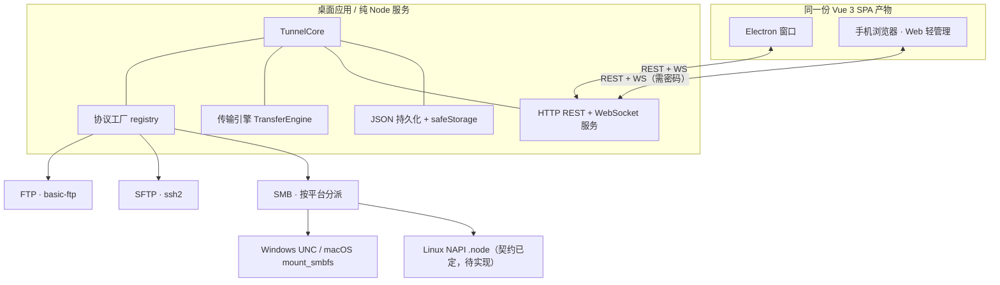

# Tunnel

<p>
  <a href="https://github.com/ZXflake/tunnel"></a>
  <a href="#进度与待办"></a>
  <a href="https://www.typescriptlang.org/"></a>
  <a href="https://vuejs.org/"></a>
  <a href="https://www.electronjs.org/"></a>
  <a href="#平台与协议支持现状"></a>
  <a href="#进度与待办"></a>
</p>

> **纯 AI 生成**：需求讨论、架构决策、代码实现、文档与端到端自测均由 AI 产出。

**源码仓库：[github.com/ZXflake/tunnel](https://github.com/ZXflake/tunnel)** · 公开 · 默认分支 `main`

*徽标为静态状态标记；项目暂未配置 CI，也没有 Release 与许可证，自测数字来自本地 `npm run test:e2e`。*

本地优先的多协议文件传输器。一个桌面应用同时承担协议工厂、传输引擎与 Web 服务；同一份 Vue 3 界面既跑在 Electron 窗口里，也能被手机浏览器打开做轻管理。

支持 FTP / SFTP / SMB（SMB 2.02+）的连接管理、目录浏览、双向传输、断点续传与队列管理，目标是 macOS / Windows / Linux 三平台各出一个自包含安装包。

> **当前状态：开发中（WIP）。** 核心链路已跑通，`npm run test:e2e` 94 项全部通过；Linux SMB 原生模块、三平台签名公证、真机 GUI 点验尚未完成，详见[进度与待办](#进度与待办)。

## 设计取舍

| 决策                                         | 原因                                                  |
| ------------------------------------------ | --------------------------------------------------- |
| 不做移动端原生 App，桌面端内置可选 Web 服务                 | 桌面应用即服务器，不依赖云端、账号或中继；手机浏览器零安装即可查看进度                 |
| Node / TypeScript 单一栈，不引入 Go 核心或 Samba 二进制 | 保持可维护性，避免多语言构建与 GPL 依赖                              |
| 协议工厂 + 统一适配器接口                             | 新增协议只需实现接口并注册，传输引擎与 UI 不感知协议差异                      |
| 不考虑 SMB1（NT1/CIFS）                         | 已废弃且不安全；不允许协商降级，只支持 SMB 2.02 及以上                    |
| 一套 REST + WebSocket API 同时服务桌面与 Web        | 业务数据不走 IPC；IPC 只保留系统对话框、`safeStorage`、token 等桌面专属能力 |

## 主要功能

- **连接管理**：新建 / 编辑弹窗，地址、端口、凭据、按协议展开的选项；密码经 `safeStorage` 加密落盘，绝不明文；Web 端不返回密码。
- **文件浏览**：左侧本地、右侧远程；列头全可排序（目录置顶、中文自然排序）、列显隐与列宽拖拽、左右分栏比例拖拽；单击单选、Ctrl/⌘ 增减、Shift 连选、拖拽矩形框选、双击进入目录，触屏退化为复选框。创建时间在 FTP / SFTP 取不到时显示「—」，不拿 mtime 冒充。
- **双向传输**：单个文件或整个文件夹都可直接下载 / 上传；文件夹在服务端递归展开成「一个任务 = 一个文件」，保留相对目录结构、跳过符号链接、单批 5000 文件上限、整批统一同名后缀、扫描可取消。
- **传输队列**：并发 3、`.part` 临时文件 + 原子 rename、续传前远端 `stat` 校验 size / mtime、暂停 / 继续 / 取消、全部暂停 / 全部开始 / 清除已完成 / 清除全部（二次确认）、创建时间与 ETA、滑动窗口速度。取消只删 `.part`，**绝不删成品**。
- **任务持久化**：队列与已传输字节落盘，重启后可续传；进度约 200ms 节流后广播，多客户端共享同一份状态。
- **手机 Web 轻管理**：查看连接状态、浏览远程目录、查看队列与进度、开始 / 暂停 / 取消、新增下载任务；不含上传与远程文件管理。
- **界面布局**：三个区域之间、文件浏览左右两栏之间均可拖拽调整；连接管理与传输队列可收起；新建任务时自动展开队列；偏好保存在浏览器本地。

## 架构



Electron 主进程与 `TunnelCore` 解耦：纯 Node 入口（`src/main/cli.ts`）可以直接跑完整后端 + Web UI，便于开发、自测与未来的无界面服务版。

## 技术栈

| 层   | 选型                                             |
| --- | ---------------------------------------------- |
| 桌面壳 | Electron 33                                    |
| 前端  | Vue 3 + TypeScript + Vite 6                    |
| 协议  | `basic-ftp`、`ssh2`、SMB 可插拔适配器                  |
| 服务  | Node `http` + `ws`，REST + WebSocket            |
| 凭据  | Electron `safeStorage`（纯 Node 模式用开发密钥，仅用于本地开发） |
| 打包  | electron-builder（dmg / nsis / AppImage + deb）  |
| 自测  | `tsx` + 临时 FTP 服务器（`ftp-srv`），端到端覆盖真实传输        |

## 快速开始

环境要求：Node.js 20+、npm。

```bash
git clone https://github.com/ZXflake/tunnel.git
cd tunnel
npm install
npm run build          # 生成 dist/main 与 dist/renderer
npm run dev:core       # 纯 Node 服务，浏览器打开 http://127.0.0.1:8787
```

`dev:core` 启动时会打印**本机一次性 token**，在登录页「本机一次性 token」处粘贴即可。该模式用本地密钥加密凭据，仅用于开发与自测。

```bash
npm run dev:electron   # 桌面版（会自动先构建）
npm run dev:web        # 仅前端 HMR（需先启动后端服务）
npm run dist           # 出三平台安装包
```

**手机访问**：在桌面客户端「设置 → Web 访问」中手动开启局域网访问并设置密码，然后用同一局域网内的浏览器打开 `http://<桌面机局域网 IP>:8787`。默认只监听 `127.0.0.1`，局域网访问默认关闭。

> `.npmrc` 固定了官方 npm 源，并把 Electron / electron-builder 二进制指向国内镜像，用于规避 GitHub Releases 下载超时。`dev:electron` 会先运行 `scripts/ensure-electron.mjs` 检查运行时二进制；受限宿主环境可显式设置 `TUNNEL_ELECTRON_NO_SANDBOX=1`。

### 命令一览

| 命令                                 | 用途                            |
| ---------------------------------- | ----------------------------- |
| `npm run typecheck`                | TypeScript 类型检查               |
| `npm run build:main` / `build:web` | 分别构建主进程 / 前端                  |
| `npm run build`                    | 两者一起构建                        |
| `npm run dev:core`                 | 纯 Node 服务（默认 8787）            |
| `npm run dev:web`                  | Vite 前端开发服务器                  |
| `npm run dev:electron`             | 启动桌面版                         |
| `npm run test:e2e`                 | 端到端自测（需先 `npm run build:web`） |
| `npm run dist`                     | electron-builder 打包           |

## 目录结构

```text
src/
  shared/          跨端类型、路径与格式化工具
  main/
    core/          TunnelCore、连接管理、传输引擎、目录展开、事件总线
    protocols/     协议工厂与 FTP / SFTP / SMB 适配器
    server/        HTTP / WebSocket 服务与访问认证
    store/         JSON 持久化、凭据加密
    electron.ts    Electron 主进程入口
    cli.ts         纯 Node 服务入口
    preload.ts     桌面专属 IPC 桥
  renderer/        Vue 3 SPA（App、四个面板、api.ts、布局纯逻辑）
scripts/           e2e 自测与 Electron 启动辅助脚本
native/            Linux NAPI 原生产物的随包位置（当前仅占位）
需求描述.md        完整需求、技术决策与逐轮落地记录
```

## API 概览

REST（均需鉴权，`/api/health` 除外）：

| 方法       | 路径                                             | 用途                         |
| -------- | ---------------------------------------------- | -------------------------- |
| GET      | `/api/bootstrap`、`/api/settings`               | 应用信息 / Web 访问设置（PUT 修改）    |
| GET/POST | `/api/connections`                             | 列出 / 新建连接                  |
| POST     | `/api/connections/:id/connect` `/disconnect`   | 建立 / 断开浏览会话                |
| DELETE   | `/api/connections/:id`                         | 删除连接                       |
| GET      | `/api/browse`、`/api/local`                     | 浏览远程 / 本地目录                |
| GET/POST | `/api/tasks`                                   | 列出 / 创建任务                  |
| POST     | `/api/tasks/expand`、`/api/tasks/expand-upload` | 文件夹下载 / 上传递归展开             |
| POST     | `/api/tasks/bulk`                              | 全部暂停 / 全部开始 / 清除已完成 / 清除全部 |
| POST     | `/api/tasks/:id/pause` `/resume` `/cancel`     | 单任务控制                      |
| DELETE   | `/api/tasks/:id`                               | 移除任务                       |

WebSocket `/ws?token=...` 推送 `snapshot`、`task`、`task-removed`、`tasks-removed`、`connection` 消息；重连会收到一份全量快照。

## 安全设计

- 默认仅监听 `127.0.0.1`；局域网访问需手动开启，外部访问强制密码 + session token（WS 同样校验）。
- 本机客户端使用启动时生成的一次性 token 免登录；登录有失败限流。
- 校验 Host / Origin，拒绝伪造 Host（防 DNS rebinding）；不做公网映射 / UPnP / 中继。
- 密码用系统钥匙串加密落盘；Linux 缺 libsecret 时明确提示降级。
- 本地目录浏览限制在主目录 / 临时目录内，避免 Web 端任意读盘；上传接口仅桌面本机可用，Web 端返回 403。

## 平台与协议支持现状

| 协议 / 平台                     | 状态                                                    |
| --------------------------- | ----------------------------------------------------- |
| FTP / FTPS、SFTP             | 已实现并有真实 FTP 端到端自测覆盖                                   |
| SMB · Windows / macOS       | OS 原生后端代码就位（UNC / `mount_smbfs`），待真机点验                |
| SMB · Linux                 | NAPI 绑定契约与加载占位已定，Rust `smb2` 绑定待实现；加载失败不影响 FTP / SFTP |
| SMB1                        | 明确不支持，也不允许降级                                          |
| macOS / Windows / Linux 安装包 | electron-builder 配置就位；签名公证证书待准备                       |

## 进度与待办

已落地：协议工厂与三类适配器、传输引擎（续传 / 状态机 / 持久化 / 进度广播）、REST + WS 服务与认证、Electron 壳与共用 SPA、连接弹窗、文件浏览多选与列模型、文件夹双向递归展开、队列批量操作、三区域与浏览区可拖拽布局、端到端自测 94 项。

待办：

- Linux NAPI 的 Rust 绑定实现与 x64 / arm64 原生产物；
- macOS 公证、Windows 代码签名与三平台安装包实测；
- 真机 GUI 逐项点验（拖拽手感、列设置菜单、窄屏表现）；
- 远程文件管理（新建目录 / 重命名 / 删除，接口已预留）；
- 「纯本地版本」在开启局域网服务后的措辞修订、是否提供自签 HTTPS 与便携版。

## 相关文档

完整的原始需求、逐轮讨论结论、技术约定与落地状态见 [需求描述.md](./需求描述.md)。

## 许可证

尚未指定。
